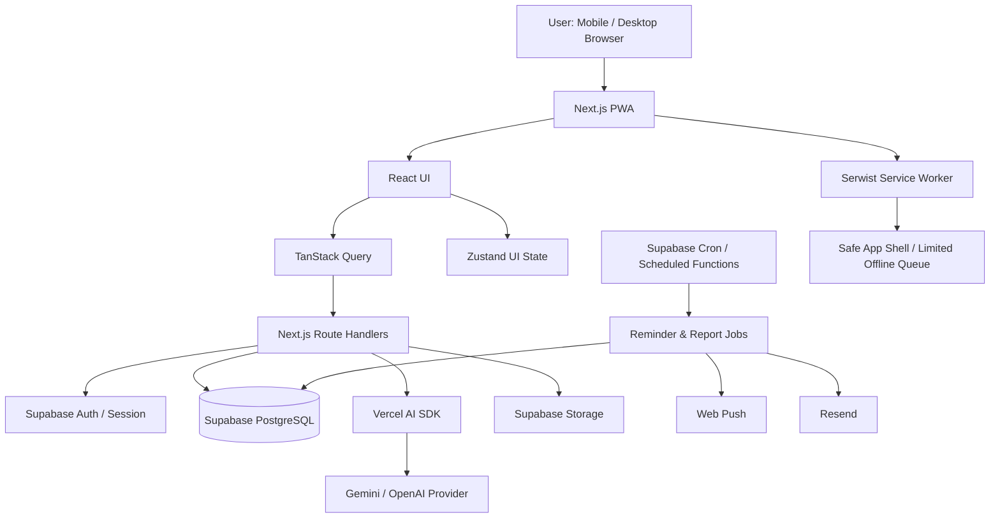
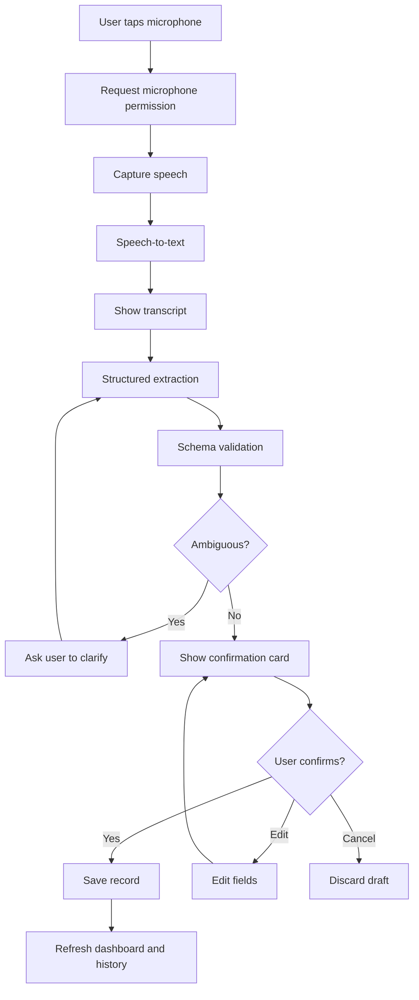
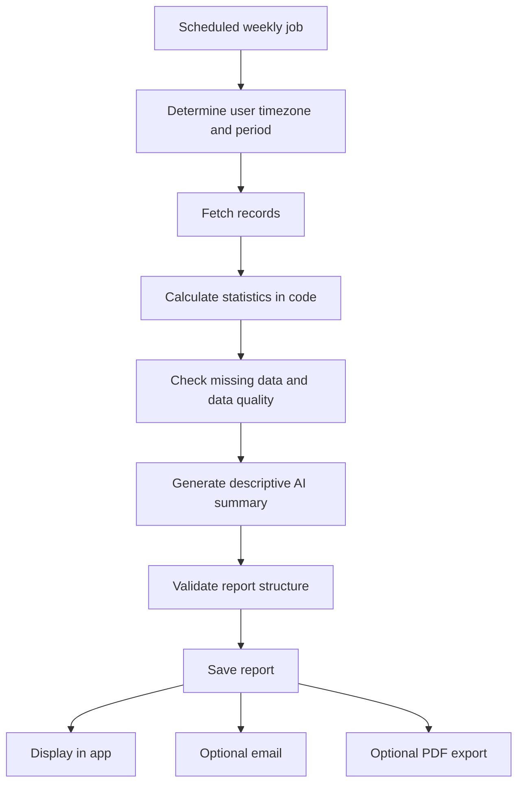

# Personal Health Tracking Companion PWA
## Technical Architecture & Implementation Documentation

**Document status:** Technical baseline  
**Product:** Personalized, voice-first health tracking PWA  
**Primary user:** One authenticated user initially (with the possibility of broader use later)  
**Platform:** Mobile-first Progressive Web App  
**Last updated:** November 2026

---

## 1. Purpose

This document defines the technical architecture, technology stack, application structure, data model, security model, integrations, development workflow, and implementation phases for the Personal Health Tracking Companion.

It is the technical source of truth for implementation. AI coding agents should use this document together with the product requirements document (PRD), and should not independently change architectural decisions without documenting the reason and requesting approval.

The application is a personal tracking and organization tool. It is **not a medical device, diagnostic system, treatment recommendation system, or replacement for a healthcare professional**.

## 2. Product Summary

The application helps the user record and review health measurements with minimal effort. It supports:

- Glucose measurements, including fasting and meal-associated readings
- Blood pressure
- Weight
- Custom tracking categories where appropriate
- Manual and voice-based logging
- Personalized tracking schedules
- Reminders and follow-ups
- Dashboard with daily completion status
- History, filters, and charts
- AI assistant for retrieving and explaining recorded data
- Weekly summaries and downloadable reports
- Installable PWA experience
- Optional email and push notifications

The application must preserve measurement context and never silently infer missing values.

## 3. Architectural Principles

1. **Database is the source of truth.** AI output and client state are not authoritative records.
2. **Validate all inputs.** Client validation improves UX; server validation is mandatory.
3. **Privacy by default.** Health records are private to the authenticated user.
4. **AI is assistive, not clinical.** No diagnosis, prescriptions, treatment decisions, or unsupported risk interpretation.
5. **Deterministic calculations.** Statistics are calculated in application code, not generated by an LLM.
6. **Explicit confirmation for AI-extracted records.** Extracted measurements are reviewed before saving, unless the user explicitly enables a trusted workflow later.
7. **Modular architecture.** Features are separated by domain and can be implemented and tested independently.
8. **Mobile-first and accessible.** Prioritize one-handed use, readable text, clear controls, and responsive layouts.
9. **Progressive enhancement.** Core manual logging should work even when voice, push, or offline features are unavailable.
10. **No unnecessary infrastructure.** Start as a modular full-stack application; do not introduce microservices, Kubernetes, Redis, or agent orchestration without demonstrated need.

## 4. Final Technology Stack

### 4.1 Application

| Layer | Technology | Responsibility |
|---|---|---|
| Full-stack framework | Next.js App Router | Routing, rendering, server-side code, route handlers |
| UI | React | Interactive interface |
| Language | TypeScript | Type safety |
| Styling | Tailwind CSS | Responsive design and styling |
| UI components | shadcn/ui | Accessible customizable primitives |
| Icons | Lucide React | Iconography |
| Client state | Zustand | Shared client/UI state |
| Server state | TanStack Query | Fetching, caching, mutations, invalidation |
| Forms | React Hook Form | Form state and submission |
| Validation | Zod | Runtime validation and schemas |
| Charts | Recharts | Measurement visualizations |

### 4.2 Backend and data

| Layer | Technology | Responsibility |
|---|---|---|
| Backend platform | Supabase | Managed backend services |
| Database | PostgreSQL | Relational data |
| Authentication | Supabase Auth | User identity and sessions |
| Authorization | PostgreSQL Row Level Security | Enforce user-specific access |
| Server functions | Supabase Edge Functions and Next.js Route Handlers | Backend workflows |
| File storage | Supabase Storage | Optional generated reports/files |
| Scheduling | Supabase Cron / scheduled functions | Reminders and report jobs |

### 4.3 AI and voice

| Layer | Technology | Responsibility |
|---|---|---|
| AI integration | Vercel AI SDK | Provider abstraction, streaming, structured generation |
| Model provider | Gemini or OpenAI, selected/configured separately | Extraction, conversational answers, report wording |
| Structured output | AI SDK + Zod | Schema-constrained extraction |
| Speech input | Web Speech API where supported | Browser speech recognition |
| Transcription fallback | Approved speech-to-text API | Transcription where native support is insufficient |

AI provider choice, model, costs, privacy terms, retention, and regional availability must be evaluated before production use. Provider keys must never be exposed in client code.

### 4.4 PWA, communications, and deployment

| Layer | Technology | Responsibility |
|---|---|---|
| PWA manifest | Web App Manifest | Install metadata and icons |
| Service worker | Serwist | Offline shell, caching, push handling |
| Push notifications | Web Push API | Reminders on supported devices |
| Email | Resend | Reminder/report emails |
| PDF | jsPDF | Export reports |
| Hosting | Vercel | Next.js hosting |
| Version control | Git + GitHub | Source control and collaboration |
| Package manager | npm | Dependency management |
| Unit/component tests | Vitest + Testing Library | Component and logic tests |
| E2E tests | Playwright | Browser workflow testing |

**Compatibility note:** Exact package versions and integration instructions must be checked against the official documentation when project setup begins. PWA integrations and framework packages can change quickly.

## 5. System Architecture

### 5.1 High-level diagram



### 5.2 Responsibilities

**Next.js application**
- Render pages and interactive UI
- Manage navigation
- Validate requests
- Expose server-only API routes
- Perform authenticated backend operations
- Call AI providers through server-side integrations

**Supabase**
- User authentication
- Persistent database
- Row-level access control
- Storage
- Scheduled backend jobs and Edge Functions

**AI provider**
- Convert natural-language input into a proposed structured measurement
- Answer questions based on explicitly retrieved records/statistics
- Generate descriptive report text from supplied statistics

**PWA service worker**
- Cache the application shell and safe static assets
- Handle push notifications
- Provide limited offline functionality
- Avoid indiscriminate caching of sensitive health data

## 6. Application Structure

Use a feature-oriented modular structure.

```text
health-tracker/
├── public/
│   ├── icons/
│   ├── manifest.webmanifest
│   └── assets/
├── src/
│   ├── app/
│   │   ├── (auth)/
│   │   │   ├── login/
│   │   │   ├── signup/
│   │   │   └── reset-password/
│   │   ├── (app)/
│   │   │   ├── dashboard/
│   │   │   ├── log/
│   │   │   ├── history/
│   │   │   ├── insights/
│   │   │   ├── reports/
│   │   │   └── settings/
│   │   ├── api/
│   │   │   ├── ai/
│   │   │   ├── measurements/
│   │   │   ├── reports/
│   │   │   └── notifications/
│   │   ├── layout.tsx
│   │   ├── page.tsx
│   │   └── globals.css
│   ├── components/
│   │   ├── ui/
│   │   ├── layout/
│   │   ├── navigation/
│   │   ├── dashboard/
│   │   ├── measurement/
│   │   ├── charts/
│   │   ├── reminders/
│   │   └── reports/
│   ├── features/
│   │   ├── auth/
│   │   ├── profile/
│   │   ├── tracking-config/
│   │   ├── glucose/
│   │   ├── blood-pressure/
│   │   ├── weight/
│   │   ├── custom-metrics/
│   │   ├── voice-logging/
│   │   ├── reminders/
│   │   ├── history/
│   │   ├── insights/
│   │   ├── ai-assistant/
│   │   └── weekly-reports/
│   ├── lib/
│   │   ├── supabase/
│   │   │   ├── client.ts
│   │   │   ├── server.ts
│   │   │   └── middleware.ts
│   │   ├── ai/
│   │   │   ├── providers.ts
│   │   │   ├── schemas.ts
│   │   │   ├── prompts/
│   │   │   └── safety.ts
│   │   ├── query/
│   │   │   └── query-client.ts
│   │   ├── validation/
│   │   ├── calculations/
│   │   ├── notifications/
│   │   ├── pdf/
│   │   └── utils/
│   ├── store/
│   │   ├── app-store.ts
│   │   ├── voice-store.ts
│   │   └── preferences-store.ts
│   ├── hooks/
│   ├── types/
│   └── config/
├── supabase/
│   ├── migrations/
│   ├── functions/
│   │   ├── send-reminders/
│   │   ├── generate-weekly-report/
│   │   └── send-email/
│   └── seed.sql
├── tests/
│   ├── unit/
│   ├── components/
│   └── e2e/
├── .env.example
├── README.md
├── package.json
└── ...
```

### Structure rules

- `app/` contains routes and page-level composition.
- `features/` contains domain-specific UI, hooks, schemas, and service logic.
- `components/` contains reusable components that are not tied to one feature.
- `lib/` contains infrastructure and shared utilities.
- `store/` contains Zustand stores only for client state.
- Supabase access must be centralized in typed clients and service modules.
- Do not place all business logic inside page components.
- Do not create a single giant `utils.ts` file.

## 7. State Management

### 7.1 TanStack Query — server state

Use TanStack Query for data that comes from the backend:

- Measurement lists
- Dashboard data
- Tracking configurations
- Reminder settings
- Reports
- User profile data
- AI query results, when appropriate

Responsibilities:
- Fetching
- Caching
- Loading/error state
- Mutations
- Cache invalidation
- Refetching
- Optimistic updates only when safe and reversible

Suggested query key convention:

```typescript
["measurements", userId, metricType, dateRange]
["dashboard", userId, selectedDate]
["tracking-config", userId]
["reminders", userId]
["reports", userId]
```

### 7.2 Zustand — client state

Use Zustand for small shared UI/workflow state:

- Selected date
- Active log type
- Voice logging step
- Temporary extracted measurement before confirmation
- Global modal state if needed
- UI preferences not stored in the database

Do not duplicate persistent database records in Zustand.

### 7.3 Local component state

Use React state for isolated component behavior:
- Open/closed dropdown
- Input focus
- Local tab
- Temporary display state

## 8. Database Design

The schema should be normalized and migration-controlled. The following is the initial logical schema; exact SQL types, constraints, indexes, and migrations will be defined before implementation.

### 8.1 `profiles`

| Column | Type | Description |
|---|---|---|
| id | UUID | Same as authenticated user ID |
| display_name | Text | Optional display name |
| timezone | Text | IANA timezone |
| locale | Text | Preferred language/locale |
| created_at | Timestamp | Creation time |
| updated_at | Timestamp | Last update |

### 8.2 `tracking_configs`

| Column | Type | Description |
|---|---|---|
| id | UUID | Primary key |
| user_id | UUID | Owner |
| metric_type | Enum/Text | glucose, blood_pressure, weight, custom |
| enabled | Boolean | Whether tracking is active |
| schedule | JSONB | Configured schedule |
| provider_targets | JSONB | Optional targets explicitly supplied by clinician |
| unit | Text | Measurement unit |
| created_at | Timestamp | Creation time |
| updated_at | Timestamp | Last update |

Targets must not be populated with generic medical thresholds by the application.

### 8.3 `glucose_records`

| Column | Type | Description |
|---|---|---|
| id | UUID | Primary key |
| user_id | UUID | Owner |
| value | Numeric | Glucose measurement |
| unit | Text | Unit |
| measured_at | Timestamp with timezone | Actual measurement time |
| entered_at | Timestamp with timezone | Record creation time |
| meal_context | Text/Enum | fasting, breakfast, lunch, dinner, snack, unknown |
| timing | Text/Enum | before, after, unknown |
| elapsed_minutes | Integer, nullable | Time after meal, if known |
| notes | Text, nullable | Optional notes |
| source | Text/Enum | manual, voice, import |
| created_at | Timestamp | Creation time |
| updated_at | Timestamp | Last update |

### 8.4 `blood_pressure_records`

| Column | Type | Description |
|---|---|---|
| id | UUID | Primary key |
| user_id | UUID | Owner |
| systolic | Integer | Systolic value |
| diastolic | Integer | Diastolic value |
| pulse | Integer, nullable | Optional pulse |
| measured_at | Timestamp with timezone | Measurement time |
| entered_at | Timestamp with timezone | Entry time |
| notes | Text, nullable | Optional notes |
| source | Text/Enum | manual, voice, import |
| created_at | Timestamp | Creation time |
| updated_at | Timestamp | Last update |

### 8.5 `weight_records`

| Column | Type | Description |
|---|---|---|
| id | UUID | Primary key |
| user_id | UUID | Owner |
| value | Numeric | Weight |
| unit | Text | kg or lb |
| measured_at | Timestamp with timezone | Measurement time |
| entered_at | Timestamp with timezone | Entry time |
| notes | Text, nullable | Optional notes |
| source | Text/Enum | manual, voice, import |
| created_at | Timestamp | Creation time |
| updated_at | Timestamp | Last update |

### 8.6 `custom_metric_records` (optional MVP extension)

| Column | Type | Description |
|---|---|---|
| id | UUID | Primary key |
| user_id | UUID | Owner |
| metric_config_id | UUID | Custom metric configuration |
| value | Numeric/Text | Recorded value |
| unit | Text, nullable | Unit |
| measured_at | Timestamp with timezone | Measurement time |
| entered_at | Timestamp with timezone | Entry time |
| notes | Text, nullable | Optional notes |
| created_at | Timestamp | Creation time |

### 8.7 `reminders`

| Column | Type | Description |
|---|---|---|
| id | UUID | Primary key |
| user_id | UUID | Owner |
| metric_type | Text | Associated metric |
| label | Text | User-configured label |
| scheduled_time | Time | Local time |
| timezone | Text | IANA timezone |
| days_of_week | Integer array | Recurrence |
| channel | Text/Enum | push, email |
| enabled | Boolean | Enabled state |
| follow_up_minutes | Integer, nullable | Optional follow-up delay |
| created_at | Timestamp | Creation time |
| updated_at | Timestamp | Last update |

### 8.8 `notification_logs`

| Column | Type | Description |
|---|---|---|
| id | UUID | Primary key |
| user_id | UUID | Owner |
| reminder_id | UUID, nullable | Reminder reference |
| scheduled_for | Timestamp | Intended delivery |
| sent_at | Timestamp, nullable | Actual send time |
| channel | Text | push/email |
| status | Text | pending, sent, failed, skipped |
| error_message | Text, nullable | Operational error |
| created_at | Timestamp | Creation time |

### 8.9 `push_subscriptions`

Store Web Push subscription details securely and associate them with the authenticated user. Fields include:
- ID
- user_id
- endpoint
- encrypted or appropriately protected subscription keys
- device label, optional
- created_at
- last_used_at
- revoked_at

Do not expose subscriptions to other users. Implement deletion/revocation.

### 8.10 `weekly_reports`

| Column | Type | Description |
|---|---|---|
| id | UUID | Primary key |
| user_id | UUID | Owner |
| period_start | Date | Beginning of reporting period |
| period_end | Date | End of reporting period |
| statistics | JSONB | Deterministic statistics |
| summary | Text | AI descriptive summary |
| report_data | JSONB | Structured report content |
| file_path | Text, nullable | Optional PDF storage |
| generated_at | Timestamp | Generation time |
| status | Text | pending, complete, failed |

### 8.11 `ai_conversations` and `ai_messages` (only if chat history is enabled)

Conversation history is sensitive. It should be optional, have a retention policy, and be deletable.

Avoid storing unnecessary raw transcripts. Store only what is required for the selected experience.

## 9. Data Rules and Validation

### 9.1 Measurement data

- Validate values and units.
- Reject malformed or impossible input according to technical validation rules.
- Do not apply medical interpretation as a validation rule.
- Do not silently convert units without recording the normalized unit.
- Preserve the user's original input when appropriate for auditability.
- Distinguish measurement time from entry time.
- Missing values must remain missing; never convert them to zero.
- Never infer a measurement date/time without confirming the intended context.

### 9.2 AI-extracted measurements

AI extraction output must:
1. Match a Zod schema.
2. Pass business validation.
3. Show the extracted information to the user.
4. Ask for confirmation if context is ambiguous.
5. Save only after confirmation.

### 9.3 Calculations

Calculations are deterministic code:
- Average
- Minimum
- Maximum
- Count
- Change between periods
- Completion rates

Do not ask the LLM to calculate these values.

## 10. API Boundaries

Use Next.js Route Handlers for authenticated application endpoints and server-only integrations. Supabase Edge Functions can handle scheduled jobs or workflows that are better suited to Supabase's execution environment.

Example endpoint map:

| Method | Endpoint | Purpose |
|---|---|---|
| GET | `/api/dashboard` | Fetch dashboard data for date |
| GET | `/api/measurements` | List records with filters |
| POST | `/api/measurements/glucose` | Create glucose record |
| PATCH | `/api/measurements/glucose/:id` | Update record |
| DELETE | `/api/measurements/glucose/:id` | Delete record |
| POST | `/api/measurements/blood-pressure` | Create BP record |
| POST | `/api/measurements/weight` | Create weight record |
| GET | `/api/tracking-config` | Get tracking configuration |
| PUT | `/api/tracking-config` | Update tracking configuration |
| GET | `/api/reminders` | List reminders |
| POST | `/api/reminders` | Create reminder |
| PATCH | `/api/reminders/:id` | Update reminder |
| DELETE | `/api/reminders/:id` | Delete reminder |
| POST | `/api/ai/extract-measurement` | Extract structured record from text |
| POST | `/api/ai/chat` | Ask a question about records |
| GET | `/api/reports` | List weekly reports |
| POST | `/api/reports/generate` | Generate report |
| GET | `/api/reports/:id/pdf` | Export report |
| POST | `/api/notifications/subscribe` | Register push subscription |
| DELETE | `/api/notifications/subscribe` | Revoke push subscription |

### API conventions

- Authenticate every private endpoint.
- Validate request body and query parameters with Zod.
- Return consistent errors.
- Avoid exposing internal errors or secrets.
- Apply rate limits to AI endpoints.
- Use idempotency or duplicate checks for record creation where practical.
- Log operational metadata, not sensitive health data or transcripts by default.

Suggested response format:

```json
{
  "data": {},
  "error": null
}
```

Error format:

```json
{
  "data": null,
  "error": {
    "code": "VALIDATION_ERROR",
    "message": "The submitted information is invalid."
  }
}
```

## 11. AI Architecture

### 11.1 AI use cases

**Structured measurement extraction**
- Input: user's spoken or typed sentence
- Output: proposed measurement data
- Validation: Zod + domain validation
- User confirmation: required before persistence

**Data assistant**
- Interpret user question
- Determine the relevant metric and date range
- Retrieve records through authenticated backend logic
- Calculate values in deterministic code
- Send only relevant facts to the model
- Generate a concise natural-language explanation
- Display source period and data limitations

**Weekly report**
- Retrieve records for reporting period
- Calculate statistics in code
- Identify missing data
- Supply structured statistics to AI
- Generate descriptive language
- Save report and display it

### 11.2 AI safety constraints

The AI must not:
- Diagnose conditions
- Prescribe medications or dosages
- Recommend treatment changes
- Invent or alter measurement values
- Interpret measurements using generic thresholds as personalized medical advice
- Claim that a trend is clinically safe or dangerous without approved, clinician-configured guidance
- Replace advice from the healthcare professional

It should:
- Clearly distinguish recorded data from observations
- Explain when data is insufficient
- Encourage contacting the user's healthcare team for medical questions
- Encourage urgent professional help when the user reports symptoms or concerns that may require urgent attention, without attempting diagnosis
- Use respectful, non-alarmist language

### 11.3 Prompt and provider organization

Keep prompts version-controlled:

```text
src/lib/ai/prompts/
├── extraction.ts
├── data-assistant.ts
└── weekly-report.ts
```

Keep provider selection separate from feature logic:

```text
src/lib/ai/
├── providers.ts
├── schemas.ts
├── safety.ts
└── prompts/
```

No API key or provider secret may be placed in client-side code.

## 12. Voice Logging Workflow



The voice feature must have a manual input fallback. Permission denial, unsupported browser, network failure, or transcription failure must not block health logging.

## 13. Reminder Architecture

### 13.1 Reminder lifecycle

1. User configures reminder.
2. Reminder is saved with local time and timezone.
3. Scheduled backend job checks due reminders.
4. Job checks whether a record has already been logged for the relevant schedule window.
5. If not completed, send configured notification.
6. Optional follow-up is sent once.
7. Stop follow-ups when measurement is recorded, reminder is disabled, or the configured window expires.
8. Record delivery status.

### 13.2 Scheduling requirements

- Store timezone explicitly.
- Handle daylight-saving changes for relevant timezones.
- Avoid duplicate notification sends.
- Respect notification permissions.
- Respect user quiet hours.
- Allow disabling channels.
- Do not include sensitive measurement details in lock-screen notifications by default.
- Push delivery is best-effort and depends on platform/browser support.

### 13.3 Channels

Initial:
- In-app notification status
- Email
- Web Push on supported installed/browser configurations

Later:
- WhatsApp integration, only after evaluating approved provider requirements, costs, consent and message templates.

## 14. PWA and Offline Strategy

### 14.1 PWA requirements

- Manifest with application name, short name, icons, theme color and display mode
- Installable experience
- HTTPS in production
- Service worker
- App-shell caching
- Offline fallback
- Push notification handling where supported

### 14.2 Offline behavior

Initial offline support:
- Load cached app shell
- Display previously loaded non-sensitive UI where safe
- Allow creating a local draft
- Queue a pending measurement only with a deliberate, secure implementation
- Synchronize when online
- Detect duplicate submission
- Show pending/synced/failed state

Do not cache all health data by default. Offline persistence of sensitive records must be reviewed for device security, shared-device risk, retention, and encryption.

## 15. Dashboard and Analytics

### Dashboard

- Current date
- Configured measurement schedule
- Completed, pending, upcoming, skipped and missed states
- Quick manual logging
- Voice logging
- Recent measurements
- Reminder status

### Analytics

- Date range filters
- Metric-specific charts
- Group glucose by meal context and timing
- BP systolic and diastolic chart
- Weight chart
- Measurement counts
- Tracking completion
- Descriptive comparisons

Do not show a clinical status, diagnosis, or risk score unless a separate, clinically reviewed requirement and data source are established.

## 16. Weekly Report Pipeline



Report sections:
- Reporting period
- Measurements recorded
- Counts and deterministic statistics
- Tracking completion
- Missing or incomplete data
- Descriptive observations
- Questions to discuss with healthcare professional
- Data limitations

Reports should not generate treatment recommendations.

## 17. Security and Privacy

### 17.1 Authentication

- Use Supabase Auth.
- Use secure session handling appropriate for Next.js SSR.
- Protect private route groups.
- Redirect unauthenticated users to authentication pages.
- Implement logout and session expiration handling.

### 17.2 Authorization

- Enable RLS on every table containing user data.
- Policies must restrict operations to the authenticated owner.
- Never trust a `user_id` supplied by the client.
- Server operations should derive the authenticated user from the verified session.
- Use service-role credentials only in server-side jobs and never in browser bundles.

### 17.3 Secrets

Example environment variables:

```env
NEXT_PUBLIC_SUPABASE_URL=
NEXT_PUBLIC_SUPABASE_ANON_KEY=

SUPABASE_SERVICE_ROLE_KEY=

AI_PROVIDER_API_KEY=
AI_PROVIDER=

RESEND_API_KEY=

NEXT_PUBLIC_VAPID_PUBLIC_KEY=
VAPID_PRIVATE_KEY=
VAPID_SUBJECT=
```

Only variables prefixed with `NEXT_PUBLIC_` should be considered public. The service-role key, AI API key, email key, and private VAPID key must remain server-side.

### 17.4 Privacy controls

- User can delete records.
- User can export records.
- User can delete account and associated data.
- AI chat history is optional and deletable.
- Sharing reports is user-initiated.
- Do not include health details in notification previews by default.
- Minimize third-party data exposure.
- Define retention for logs and AI conversations.
- Avoid logging raw measurements or transcripts unnecessarily.

### 17.5 Production review

Before real health data is used at scale:
- Review applicable privacy laws and data protection requirements.
- Review hosting and AI provider terms.
- Confirm data region and retention settings.
- Conduct security testing.
- Assess whether any regulatory obligations apply based on intended use and deployment jurisdiction.

## 18. Error Handling and Observability

User-facing errors should be clear and actionable.

Examples:
- "Couldn't save your measurement. Check your connection and try again."
- "Voice recognition isn't available in this browser. You can enter the measurement manually."
- "Your reminder couldn't be delivered. Notification permissions or connection may be unavailable."

Do not expose:
- Stack traces
- API keys
- Database internals
- Provider error payloads
- Sensitive records in logs

Initial observability:
- Server logs with request IDs
- Error tracking integration added when needed
- AI usage/cost tracking
- Reminder delivery logs
- Failed job tracking

## 19. Testing Strategy

### Unit tests
Test:
- Calculations
- Validation schemas
- Date and timezone utilities
- Measurement parsing
- Reminder recurrence logic
- Report aggregation

### Component tests
Test:
- Measurement forms
- Confirmation cards
- Dashboard status
- Filters
- Reminder settings
- Loading/error states

### End-to-end tests
Test:
- Signup/login
- Add measurement
- Edit measurement
- Delete measurement
- Dashboard refresh
- History filtering
- AI extraction confirmation
- Reminder setup
- Report generation
- PWA installability checks where automation permits

### Manual device tests
Test on the actual intended phone:
- PWA installation
- Voice recognition
- Microphone permission
- Push notifications
- Offline behavior
- Screen sizing
- Keyboard and input behavior
- Browser-specific limitations

## 20. Deployment Workflow

### Development

- Local Next.js development server
- Supabase development project
- Local `.env.local`
- Git feature branches
- Test data only

### Staging

- Separate Supabase staging project
- Vercel preview deployment
- Test accounts and synthetic data
- Verify migrations, authentication and notification flows

### Production

- Production Supabase project
- Vercel production deployment
- HTTPS
- Environment secrets configured
- Database backups and recovery plan
- RLS policies verified
- Monitoring and error handling
- Privacy notice and user consent

Never use real health data in development or AI coding agent prompts unless there is a clearly approved, secure, necessary workflow.

## 21. Git and AI-Assisted Development Workflow

### Branching

```text
main
└── feature/<module-name>
```

Use one feature branch per meaningful module.

### Module workflow

For every module:

1. Read the PRD and technical documentation.
2. Define acceptance criteria.
3. Inspect the current repository.
4. Implement only the assigned module.
5. Run lint, typecheck and tests.
6. Review changed files.
7. Test the visible feature.
8. Fix issues.
9. Commit with a clear message.
10. Merge only when the module is stable.

### AI coding agent rules

Agents must:
- Read this document and the PRD first.
- Inspect existing files before editing.
- Avoid rewriting unrelated code.
- Follow the established folder structure.
- Use TypeScript.
- Validate inputs with Zod.
- Keep secrets server-side.
- Avoid mock data in production pathways.
- Never bypass RLS.
- Add tests for important logic.
- Explain files changed and commands run.
- Report any architectural deviation and reason.
- Do not silently add dependencies.

## 22. Implementation Phases

### Phase 0 — Architecture and setup
- Confirm repository
- Initialize Next.js
- Configure TypeScript
- Configure Tailwind and shadcn/ui
- Add linting and formatting
- Set up GitHub
- Establish environment variable conventions
- Create app shell

### Phase 1 — UI foundation
- Mobile navigation
- App layout
- Dashboard skeleton
- Theme and design tokens
- Loading, empty and error states

### Phase 2 — Authentication and backend
- Supabase project
- Auth screens
- SSR auth integration
- Database migrations
- RLS policies
- Profile setup

### Phase 3 — Tracking configuration
- Enable metrics
- Configure schedule
- Configure units
- Configure clinician-provided targets, if applicable
- Timezone and preferences

### Phase 4 — Manual measurement logging
- Glucose
- Blood pressure
- Weight
- Validation
- Edit/delete
- History
- Dashboard integration

### Phase 5 — Analytics
- Charts
- Date filters
- Statistics
- Completion tracking

### Phase 6 — Voice logging and AI
- Speech-to-text
- Transcript review
- Structured extraction
- Confirmation/edit workflow
- AI data assistant

### Phase 7 — Reminders
- Reminder configuration
- Scheduled backend jobs
- Push subscriptions
- Email
- Follow-ups
- Delivery logs

### Phase 8 — Weekly reports
- Report statistics
- AI summary
- Report history
- PDF
- Optional email delivery

### Phase 9 — PWA
- Manifest
- Icons
- Service worker
- Installation
- Offline shell
- Push handling
- Mobile testing

### Phase 10 — Production hardening
- Security review
- Accessibility review
- Automated tests
- Device testing
- Error monitoring
- Privacy and data deletion flows
- Production deployment

## 23. MVP Scope

### Must have
- Authentication
- Profile and timezone
- Tracking configuration
- Glucose records
- Blood pressure records
- Weight records
- Manual logging
- Dashboard
- History
- Charts
- Reminders
- Basic AI-assisted voice extraction
- Weekly report
- PWA installability
- Secure user-owned data

### Should have
- Push notifications
- Email notifications
- PDF export
- Offline drafts
- AI assistant querying historical data

### Later
- WhatsApp reminders
- Wearable integrations
- Additional custom metrics
- Multiple-user/family access
- Advanced report customization
- Additional languages
- More sophisticated offline sync

## 24. Definition of Done

A feature is considered complete only when:

- Acceptance criteria are met.
- UI works on mobile and desktop.
- Input validation is implemented.
- Loading, empty, error and success states are present.
- Authentication and authorization are enforced.
- Sensitive data is not exposed.
- Unit/component tests are added where appropriate.
- E2E tests are added for critical workflows.
- Typecheck and lint pass.
- The feature has been manually tested.
- Documentation is updated if architecture changes.
- Git changes are reviewed and committed.

## 25. Architectural Decisions

| Decision | Choice | Reason |
|---|---|---|
| Application | PWA | Installable, one codebase, faster iteration |
| Framework | Next.js App Router | Full-stack framework and deployment ecosystem |
| Language | TypeScript | Safer code and better agent/tooling support |
| Database | PostgreSQL | Relational health records and reliable queries |
| Backend | Supabase | Managed database, auth, storage and functions |
| Server state | TanStack Query | Caching and synchronization |
| Client state | Zustand | Lightweight shared UI state |
| AI integration | Vercel AI SDK | Provider flexibility and structured generation |
| Validation | Zod | Runtime validation |
| UI | Tailwind + shadcn/ui | Customizable responsive interface |
| Charts | Recharts | React-based visualization |
| PWA | Manifest + Serwist | Installability, service worker and caching |
| Hosting | Vercel | Integrated Next.js deployment |
| Architecture | Modular monolith | Simplicity and maintainability |

## 26. Change Management

This document is the baseline architecture.

If a technology must change:
1. Identify the problem with the current choice.
2. Explain the proposed replacement.
3. Evaluate migration cost and benefits.
4. Update this document.
5. Obtain approval before implementation.

Do not change the stack because a newer library is trending. Change it when the project has a real requirement that the current technology cannot reasonably meet.

---

**End of Technical Documentation**
